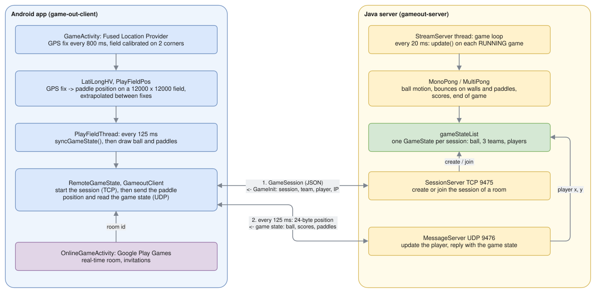
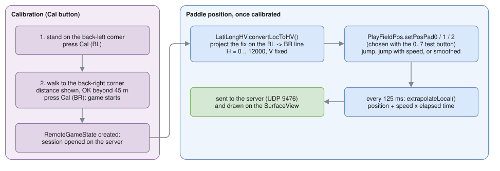

<div align="center">

# GameOut

**Android client of GameOut, a Pong game played outdoors: each player moves their paddle by walking, tracked by the phone's GPS (2015-2016).**

[](app/src/main/java/fr/ecp/sio/gameout)
[](app/src/main/AndroidManifest.xml)
[](app/build.gradle)
[](app/build.gradle)
[](gradle/wrapper/gradle-wrapper.properties)
[](#team)
[](https://github.com/erwan-rouzel/gameout-server)

</div>

## Table of contents

- [About](#about)
- [Features](#features)
- [How it works](#how-it-works)
- [Tech stack](#tech-stack)
- [Building](#building)
- [Repository layout](#repository-layout)
- [Code tour](#code-tour)
- [Team](#team)
- [License](#license)

## About

GameOut is an "Out door game mixing the fun of mobile games, retro gaming and fitness activity", as the header of
[`GameActivity.java`](app/src/main/java/fr/ecp/sio/gameout/GameActivity.java#L56-L62) puts it. The playing field is
a real area: the player calibrates it by standing on two corners, then their paddle follows them as they walk along
the back line, from GPS fixes. The ball and the scores are computed by a server, which every phone polls several
times per second.

This repository is the Android app. The server is in
**[gameout-server](https://github.com/erwan-rouzel/gameout-server)**.

It was a team project. The in-app [credits page](app/src/main/res/raw/credits.html) (in French) describes it as a
proof of concept mixing cloud computing and a mobile app, built by a team of four students, with goals such as a
cloud part ready to scale and measuring the responsiveness of the whole system to find its bottlenecks.

> This README describes the `demo-presentation` branch, the only branch of the repository. Its last code commit is
> "Modifs pour la démo" (changes for the demo), March 2016.

## Features

- **GPS paddle**: location updates from the Fused Location Provider (every 800 ms requested, high accuracy), turned
  into a position on the back line of the field.
- **Field calibration** in two steps: back-left corner, then back-right corner, with the distance walked shown
  (marked OK beyond 45 m).
- **Paddle smoothing**: between two GPS fixes, the paddle position is extrapolated from its speed; a test button
  switches between three strategies (jump, jump with speed, smoothed move with a coefficient).
- **Networked game**: the app opens a session on the server, then every 125 ms sends its paddle position over UDP
  and draws the ball and paddles from the game state that comes back.
- **Demo controls**: `<<` and `>>` buttons move the paddle without walking, and buttons start a game directly in a
  fixed demo room.
- **Google Play Games**: sign-in, real-time multiplayer rooms (quick match, invitations), leaderboards and
  achievements screens.
- **Ads**: AdMob banner and interstitial, with an ads level setting (High, Medium, Ads free).
- **Instrumentation**: [`TimeKeeper`](app/src/main/java/fr/ecp/sio/gameout/TimeKeeper.java) counts events and
  measures mean and maximum durations (GPS period, drawing, UDP round trip), shown in a debug line on the game
  screen.

## How it works

### Client and server

<picture>
  <source media="(prefers-color-scheme: dark)" srcset="docs/diagrams/client-server.dark.svg">
  
</picture>

1. When a game starts, [`RemoteGameState`](app/src/main/java/fr/ecp/sio/gameout/remote/RemoteGameState.java#L26)
   sends a `GameSession` as JSON over TCP (port 9475), with a room id: a random number, the Google Play Games room
   id, or `demoroom` for the demo buttons. The server replies with a `GameInit`: session id, team, player number
   and the address to use for the game.
2. [`PlayFieldThread`](app/src/main/java/fr/ecp/sio/gameout/PlayField/PlayFieldThread.java#L37) wakes up every
   125 ms and calls [`maj_visu`](app/src/main/java/fr/ecp/sio/gameout/PlayField/PlayFieldSurfaceView.java#L162):
   extrapolate the local paddle, send its position, read the game state, draw.
3. [`GameoutClient.sendPosition`](app/src/main/java/fr/ecp/sio/gameout/remote/GameoutClient.java#L82) packs the
   position in a 24-byte message (session id, timestamp, team, player, x, y, vx, vy) and sends it over UDP (port
   9476); the reply, decoded by
   [`GameoutClientHelper.updateGameState`](app/src/main/java/fr/ecp/sio/gameout/remote/helper/GameoutClientHelper.java#L11),
   holds the status, scores, ball and every paddle. The byte layout is detailed in the
   [server's README](https://github.com/erwan-rouzel/gameout-server#protocol).

All positions are in a virtual 12000 x 12000 field shared with the server.

### From GPS to paddle

<picture>
  <source media="(prefers-color-scheme: dark)" srcset="docs/diagrams/gps-to-paddle.dark.svg">
  
</picture>

[`LatiLongHV.convertLocToHV`](app/src/main/java/fr/ecp/sio/gameout/PlayField/LatiLongHV.java#L74) scales the
longitude by 1 / cos(latitude), projects the fix on the segment between the two calibrated corners and maps it to
0..12000; the depth of the paddle is fixed. [`PlayFieldPos`](app/src/main/java/fr/ecp/sio/gameout/PlayField/PlayFieldPos.java#L167)
then either moves the paddle straight to that point or gives it a speed toward where it should be at the next fix,
and [`extrapolateLocal`](app/src/main/java/fr/ecp/sio/gameout/PlayField/PlayFieldPos.java#L101) moves it along that
speed between fixes.

### Server address

The address of the server is set in
[`GameoutClient`](app/src/main/java/fr/ecp/sio/gameout/remote/GameoutClient.java#L33), to be changed when the server
is deployed elsewhere (step 7 of the server's
[deployment procedure](https://github.com/erwan-rouzel/gameout-server#deployment-procedure)).

## Tech stack

| Part | Technology |
|---|---|
| Language | Java |
| Platform | Android, `minSdkVersion` 9, `targetSdkVersion` 21, `compileSdkVersion` 21 |
| Location | Google Play services location 6.5.87 (Fused Location Provider) |
| Multiplayer, sign-in | Google Play Games services 6.5.87, through Google's `BaseGameUtils` helper |
| Ads | Google Play services ads 6.5.87 (AdMob) |
| JSON | Gson 2.5 (server messages), Jackson databind 2.4.4 (room messages) |
| Networking | `java.net` sockets, TCP and UDP |
| Drawing | `SurfaceView` and `Canvas` |
| Build | Gradle wrapper 2.2.1, Android Gradle plugin 1.3.0, Android Studio project |

## Building

The repository is an Android Studio / Gradle project (modules `:app` and `:libraries:BaseGameUtils`, see
[`settings.gradle`](settings.gradle)), built with the Gradle wrapper (the Google sample this app started from documented the `gradlew build` command):

```bash
./gradlew build
```

This README was written from the code; the build was not run for it. The build files date from 2015: Gradle 2.2.1,
Android Gradle plugin 1.3.0, build tools 21.1.2, dependencies resolved from JCenter, and they have not been
updated since. Running a game also needs the GameOut server, Google Play services on the phone,
and location enabled.

## Repository layout

```
.
├── app/
│   ├── build.gradle
│   └── src/main/
│       ├── AndroidManifest.xml
│       ├── java/fr/ecp/sio/gameout/
│       │   ├── GameActivity.java     game screen: GPS, calibration, demo buttons
│       │   ├── MainActivity.java     main menu, Google sign-in, ads
│       │   ├── SplashActivity.java   launcher screen
│       │   ├── TimeKeeper.java       timing instrumentation
│       │   ├── PlayField/            GPS conversion, paddle position, drawing thread and view
│       │   ├── remote/               TCP and UDP client, game state received from the server
│       │   ├── model/                game model shared with the server (GameState, Ball, Team, Player...)
│       │   ├── salon/                multiplayer room, settings, credits, instructions
│       │   ├── ads/                  interstitial ad
│       │   └── utils/                byte conversions, shared preferences
│       └── res/                      layouts, strings, credits and instructions pages, settings
├── libraries/BaseGameUtils/          Google Play Games helper library (third party)
├── build.gradle, settings.gradle, gradle/, gradlew
├── docs/
│   ├── diagrams/                     draw.io sources and their SVG exports (light and dark)
│   └── export-diagrams.sh
└── README.md
```

## Code tour

| Part | Where |
|---|---|
| Location requests, calibration, demo buttons | [`GameActivity`](app/src/main/java/fr/ecp/sio/gameout/GameActivity.java#L72), [`calibButtonHandler`](app/src/main/java/fr/ecp/sio/gameout/GameActivity.java#L287) |
| GPS to field coordinates | [`LatiLongHV.convertLocToHV`](app/src/main/java/fr/ecp/sio/gameout/PlayField/LatiLongHV.java#L74) |
| Paddle smoothing | [`PlayFieldPos.setPosPad2`](app/src/main/java/fr/ecp/sio/gameout/PlayField/PlayFieldPos.java#L167) |
| Refresh loop | [`PlayFieldThread`](app/src/main/java/fr/ecp/sio/gameout/PlayField/PlayFieldThread.java#L37), [`maj_visu`](app/src/main/java/fr/ecp/sio/gameout/PlayField/PlayFieldSurfaceView.java#L162) |
| Sync with the server | [`PlayFieldPos.syncGameState`](app/src/main/java/fr/ecp/sio/gameout/PlayField/PlayFieldPos.java#L209), [`RemoteGameState.sendPosition`](app/src/main/java/fr/ecp/sio/gameout/remote/RemoteGameState.java#L49) |
| Network client | [`GameoutClient`](app/src/main/java/fr/ecp/sio/gameout/remote/GameoutClient.java#L65) |
| Game state decoding | [`GameoutClientHelper.updateGameState`](app/src/main/java/fr/ecp/sio/gameout/remote/helper/GameoutClientHelper.java#L11) |
| Multiplayer room | [`OnlineGameActivity.onRoomConnected`](app/src/main/java/fr/ecp/sio/gameout/salon/OnlineGameActivity.java#L335) |

## Team

GameOut was built by a team. Commit authors in this repository, by GitHub login, with the roles given in the
header of [`GameActivity.java`](app/src/main/java/fr/ecp/sio/gameout/GameActivity.java#L56-L62) ("Initial team")
when listed there:

| GitHub login | Role |
|---|---|
| [erwan-rouzel](https://github.com/erwan-rouzel) | Erwan Rouzel, "Server and cloud computing"; network client of the app |
| [odeste](https://github.com/odeste) | Olivier Desté, "intial idea and Android dev"; GPS, play field and instrumentation code |
| [cquenum](https://github.com/cquenum) | Codjo Quenum, "Google Play, advertisement funding" |
| [abdelhafiz23](https://github.com/abdelhafiz23) | settings, shared preferences and ads level (`ParamActivity`) |

The repository was first hosted under the `odeste` account (`odeste/GameOut`, as the merge commits show).

## License

No license file: this was a team project.

Third-party code in this repository keeps its own license:

- [`libraries/BaseGameUtils`](libraries/BaseGameUtils) is Google's Play Games helper library (Apache License 2.0,
  per its file headers).
- The app started from Google's *Location Updates* sample (its README was in this repository until April 2016).
  Files that carry a "Copyright 2014 Google" Apache License 2.0 header keep it, such as `GameActivity.java`,
  `AndroidManifest.xml` and `res/values/strings.xml`.
